# Penge Trick

Penge Trick er en mobil webapp til et simpelt pengetrick: appen viser et billede af din egen hjemmeskærm, mens en foldet seddel eller mønt kan trækkes ud af skærmen. Effekten virker bedst, når appen er installeret på hjemmeskærmen og kører som fuldskærms-webapp.

Appen kan bruges direkte her:

[penge-trick.vercel.app](https://penge-trick.vercel.app)

## Funktioner

- Vælg et screenshot af din egen hjemmeskærm som baggrund.
- Vælg mellem flere sedler og mønter.
- Juster størrelse, rotation, baggrundsplacering og hvilken kant sedlen skal trækkes ud fra.
- Brug skjulte kontroller til indstillinger og nulstilling.
- Slå tilt til, hvis du vil styre effekten med telefonens bevægelse.

## Sådan installerer du appen på iPhone

1. Åbn Safari, gå til [penge-trick.vercel.app](https://penge-trick.vercel.app), og tryk på menuen nederst i browseren.

   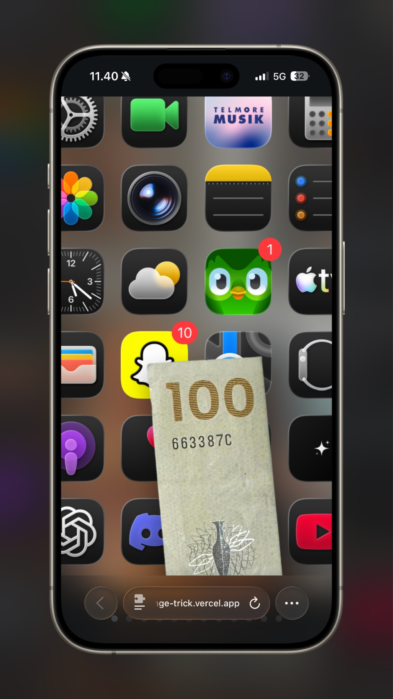

2. Tryk på **Del**.

   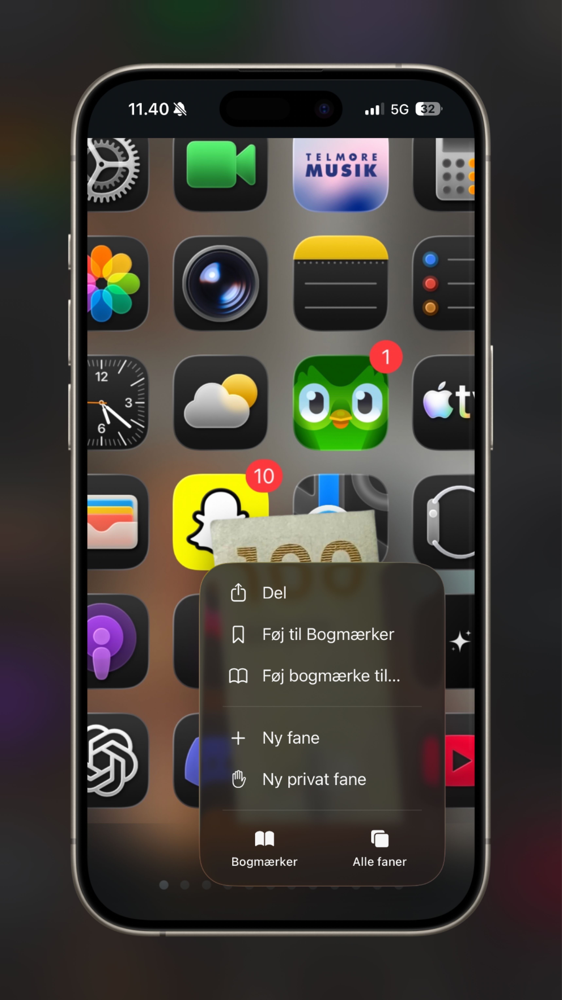

3. Tryk på **Se mere**, hvis du ikke med det samme kan se muligheden for at føje appen til hjemmeskærmen.

   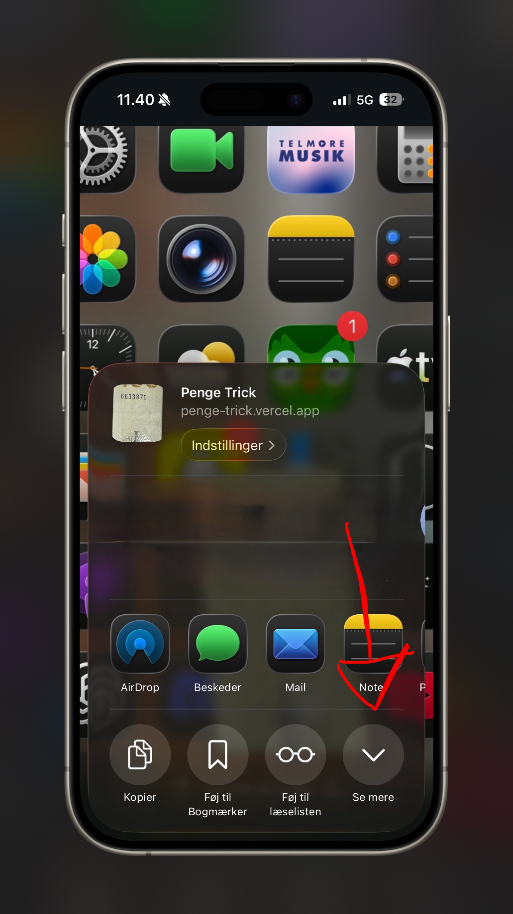

4. Scroll ned, og vælg **Føj til hjemmeskærm**.

   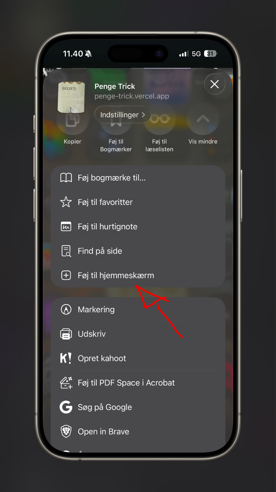

5. Tjek, at **Åbn som webapp** er slået til, og tryk derefter på **Tilføj**.

   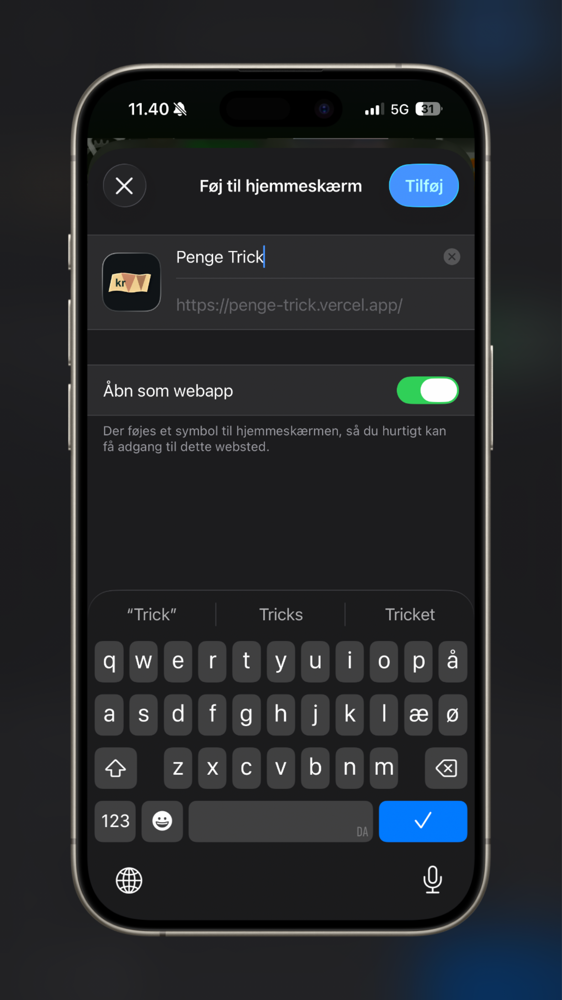

## Klargør dit hjemmeskærms-billede

1. Gå til din hjemmeskærm, og tag et screenshot.

   

2. Åbn screenshottet i Fotos, og tryk på **Rediger**.

   Hvis du har en iPhone med Apple Intelligence, kan du bruge **Visk ud** til at fjerne klokkeslættet og statuslinjen i toppen.

   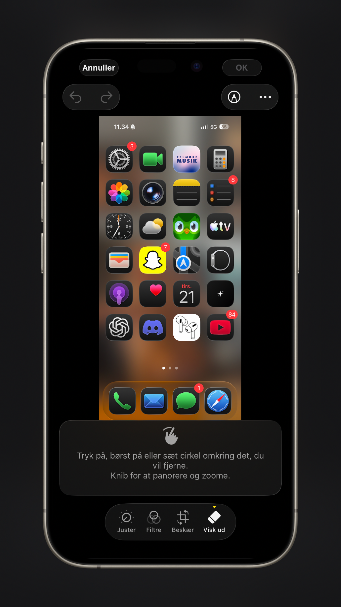

3. Marker toppen af billedet som vist. Det fjerner klokkeslættet og statuslinjen, så de ikke ligger oven i den rigtige tid, når appen bruges.

   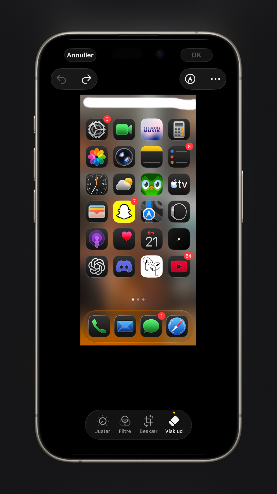

4. Tryk på **OK**, og gem billedet.

   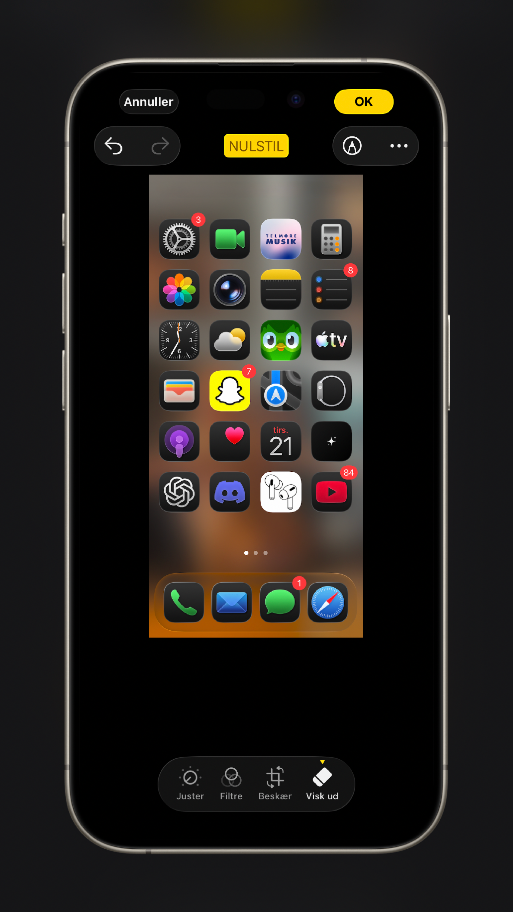

## Sådan bruger du tricket

1. Åbn Penge Trick fra hjemmeskærmen.

   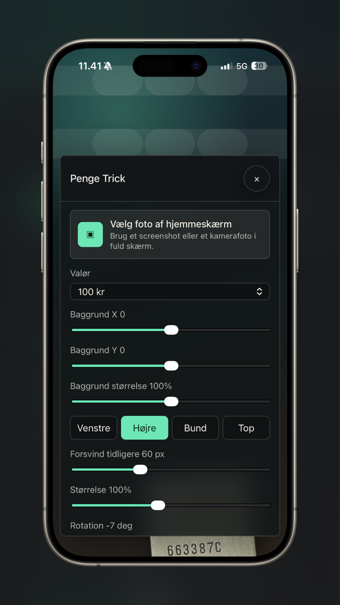

2. Tryk på **Vælg foto af hjemmeskærm**, og vælg det redigerede screenshot.

   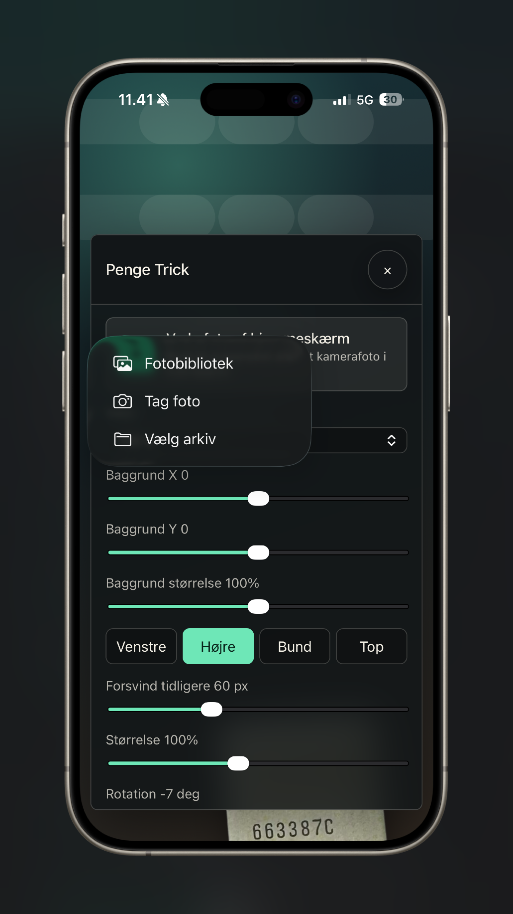

3. Når billedet er valgt, skal appen ligne din normale hjemmeskærm.

   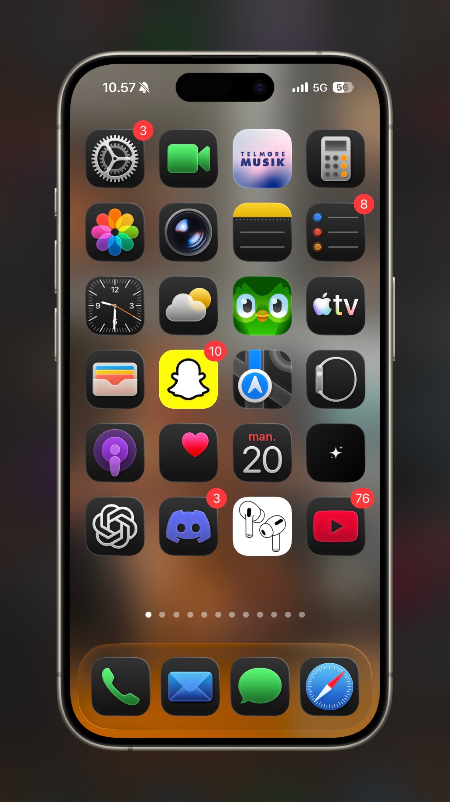

4. Tryk i øverste højre hjørne for at vise de skjulte kontroller. Her kan du åbne indstillinger eller nulstille sedlen, så den kommer tilbage.

   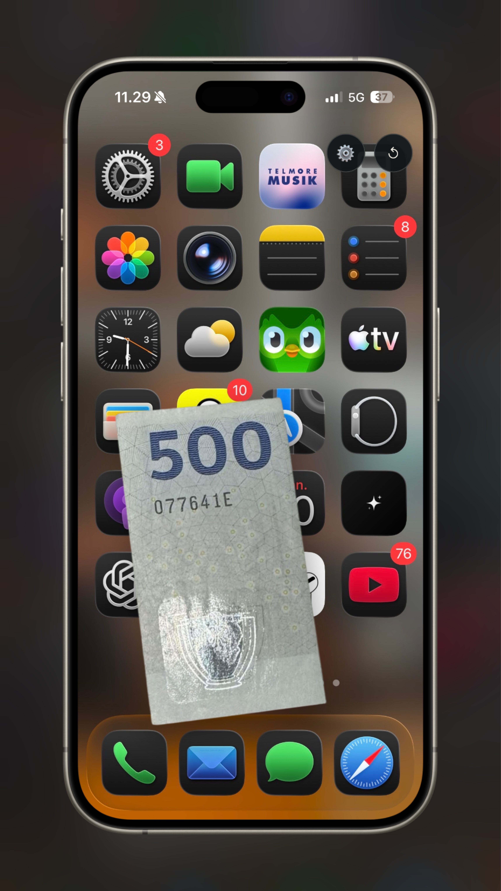

5. I indstillinger kan du vælge seddel eller mønt, hvilken side den skal trækkes ud fra, størrelse på sedlen og justering af baggrunden.

   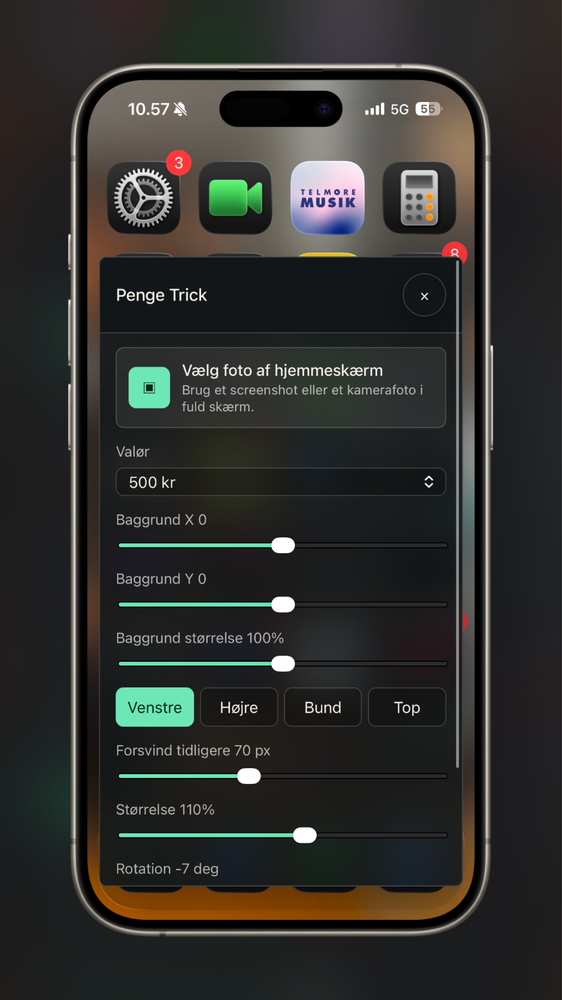

   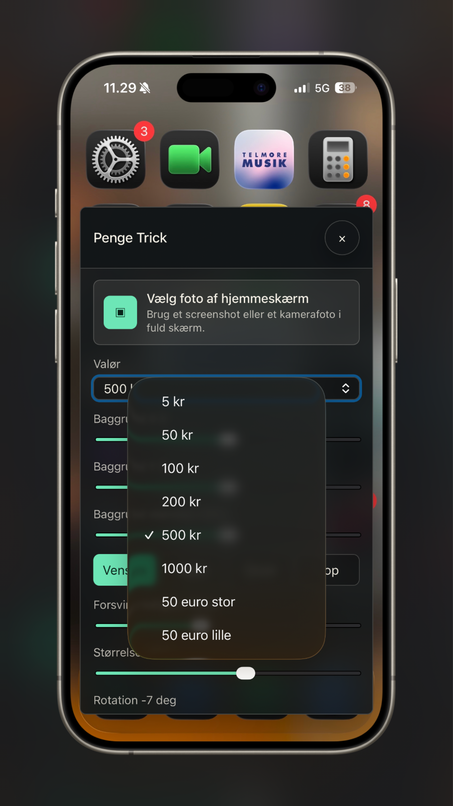

6. Tilt kan slås til, hvis du vil eksperimentere med bevægelsesstyring. Du skal acceptere tilladelsen i popuppen, før funktionen virker.

   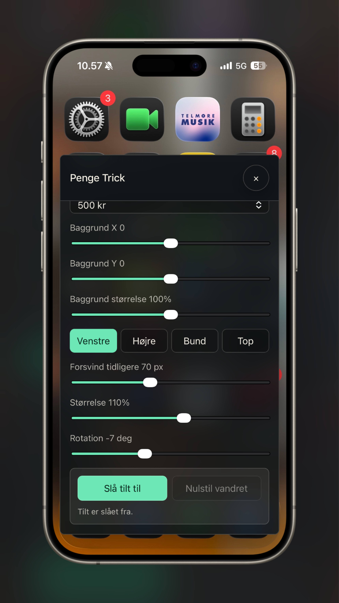

7. Læg den rigtige seddel bag telefonen. Hold telefonen og sedlen, så du kan trække den rigtige seddel ud samtidig med, at du trækker sedlen på skærmen mod den valgte kant.

   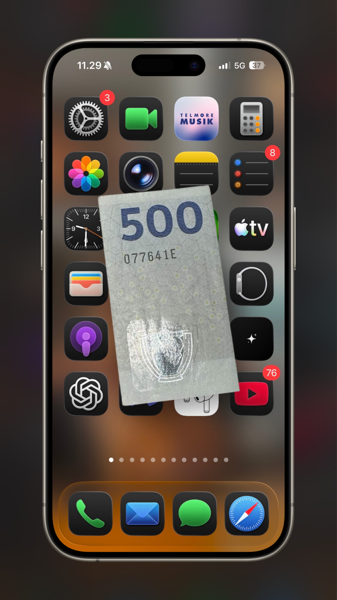

